# Design proposals — November 2026

Mockups are static HTML built from the `--om-*` tokens of the default *Mercado* theme (`themes.scss`) and rendered at 1280×800. Sources and generator scripts are in `mockups/src/`.

One shared pattern runs through these proposals: **a secondary navigation column** (about 200 px wide, next to the main rail) for any area that has sub-sections. Informes and Ajustes both use it.

## 1. Informes: sub-sections instead of an orphan "Takings" rail item

**Problem.** Informes only shows an English "Most sold" bar chart with a "Period" select, and "Takings" sits on its own in the main rail.

**Proposal.** The rail keeps a single **Informes** item. Inside it, a secondary nav lists **Resumen · Más vendidos · Recaudación · Stock bajo · Por categoría**. Stock bajo shows a badge with its count, and *Exportar CSV* sits at the bottom. Every report shares the same period segmented control: *Hoy · 7 días · 30 días · Personalizado*.

| Screen | Design decisions |
|---|---|
| 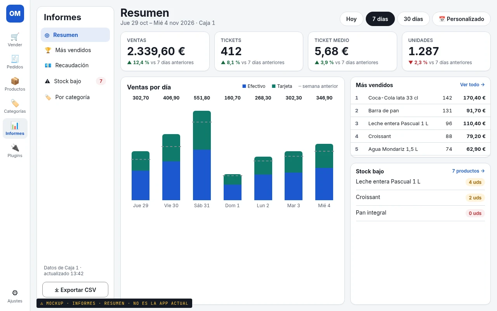 **Resumen** | KPI cards for Ventas, Tickets, Ticket medio and Unidades, each with ▲/▼ vs the previous period. A stacked daily column chart splits Efectivo and Tarjeta, with a dashed line for the previous week. Next to it: top 5 products and a stock-bajo preview, each with a "ver todo" link. |
| 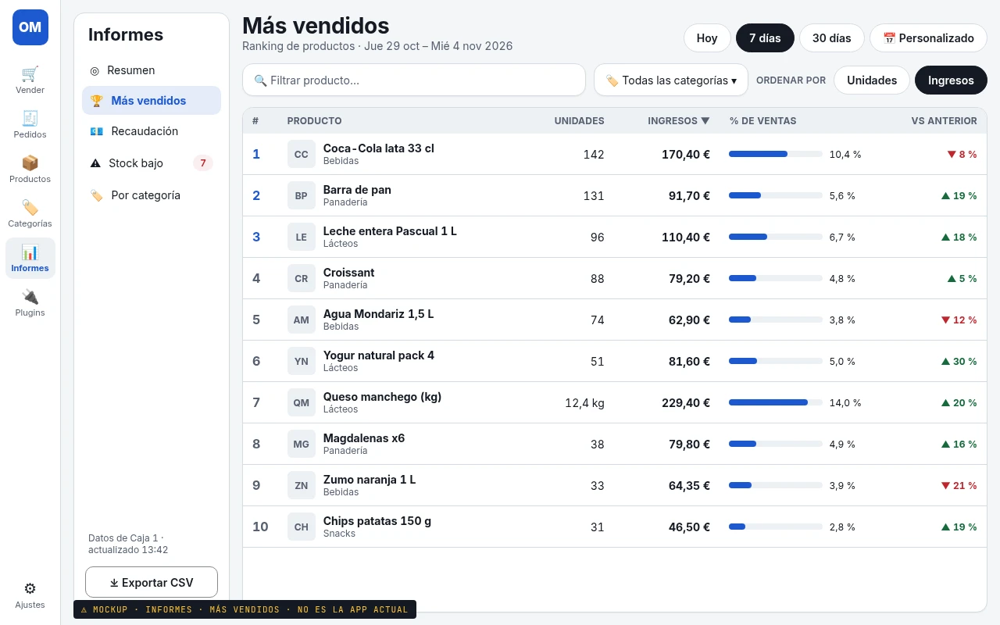 **Más vendidos** | A ranked table with a thumbnail and category, units (kg for weighted items), revenue, a share-of-sales bar and the trend vs the previous period. Sort with *Unidades / Ingresos*. Filters for product text and category. |
| 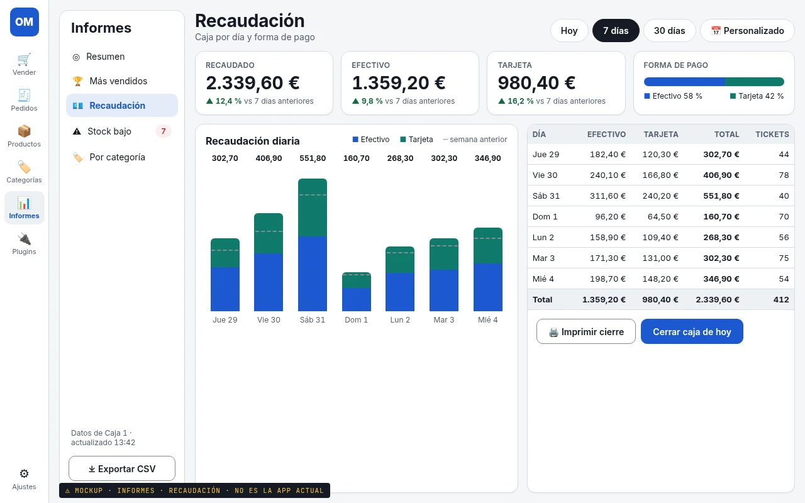 **Recaudación** | KPIs for Recaudado, Efectivo and Tarjeta, plus a payment-method split bar. A daily stacked chart sits beside a per-day table with a totals row. *Imprimir cierre* and *Cerrar caja de hoy* actions. |
| 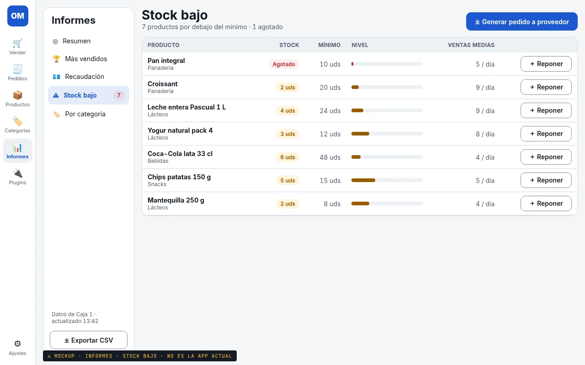 **Stock bajo** | Stock vs minimum, a level bar, average sales per day and a *Reponer* button on each row. *Generar pedido a proveedor* at the top. |

Money uses the Spanish format (`2.339,60 €`).

## 2. Vender: a category filter that scales

**Problem.** The category tabs wrap onto 2+ rows and push the product grid down. The mockups use 25 categories to stress-test each option.

| Option | Pros | Cons |
|---|---|---|
| **(a) Chips + "Más (25) ▾"** 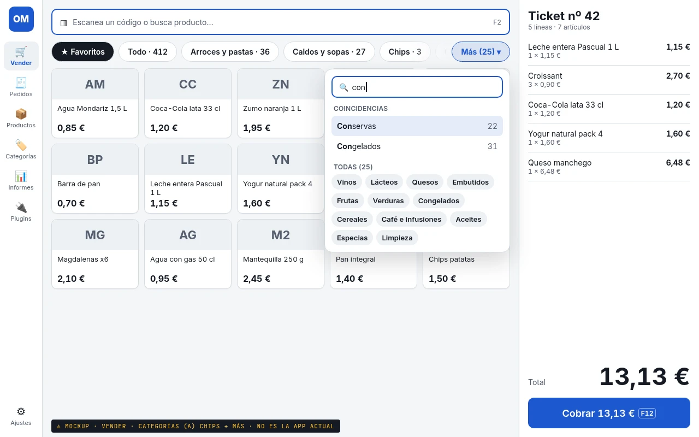 | Closest to today's look. Favoritos and Todo stay one tap away. Fixed height of one row. The popover's search helps keyboard users. | Horizontal swipe is easy to miss. The order of visible chips needs a rule (pinned or most used). Reaching a category in the popover takes 2 taps. |
| **(b) Combobox beside the search field** 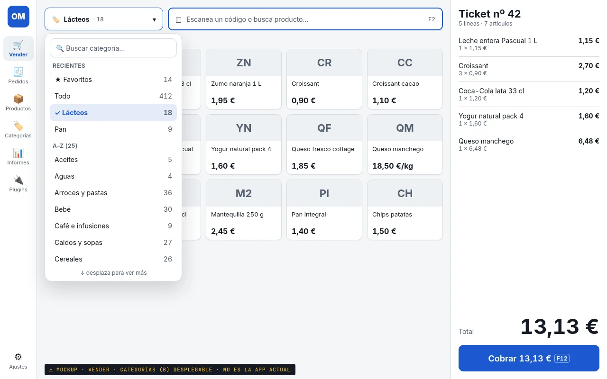 | Takes the least space and gives the grid the most room. Includes a "Recientes" section and type-ahead. | Always 2 taps. The active filter is less visible, which is why there's a "Quitar filtro" hint. The list is small for fingers. |
| **(c) Collapsible vertical list with counts** 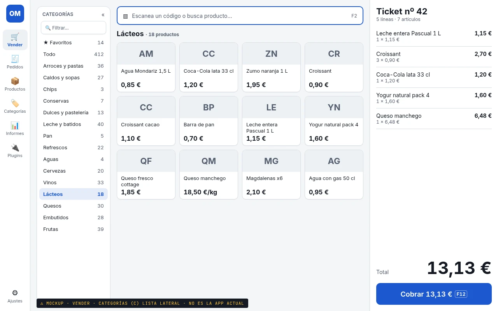 | Every category is visible with 1 tap and big targets. Counts are shown. Scrolls vertically, which is natural on touch. Matches the secondary-nav pattern. | Costs about 190 px of grid width (5 columns become 4). Needs a collapse («) for the scanner layout. |

**Recommendation for a touch POS: (c)**, collapsible and remembered per layout. Default it to open in *Táctil* and collapsed in *Escáner*/*Mostrador*. A collapsed state could fall back to (a)'s single chip row.

## 3. Ajustes: no more lost "Guardar"

**Problem.** One long page of cards (Negocio, Ticket, Impresora, Apariencia, Idioma), with the Guardar button scrolling out of view.

| Option | Pros | Cons |
|---|---|---|
| **(a) Secondary nav + dirty bar** 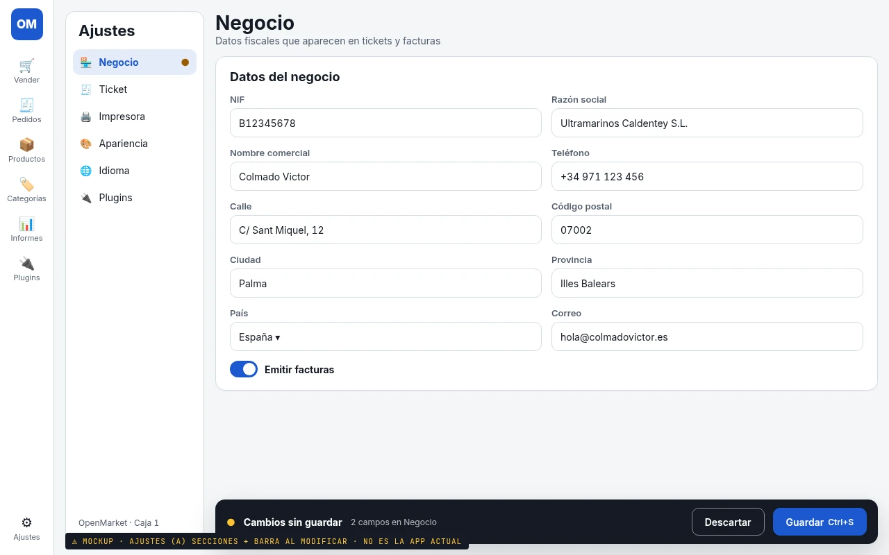 | One short section at a time. The bar shows up only when something has changed (*Cambios sin guardar · Descartar · Guardar*, Ctrl+S). The dot in the nav marks the edited section. Same pattern as Informes. | Leaving a section with unsaved changes needs a guard or confirmation. |
| **(b) Long page + sticky anchor tabs** 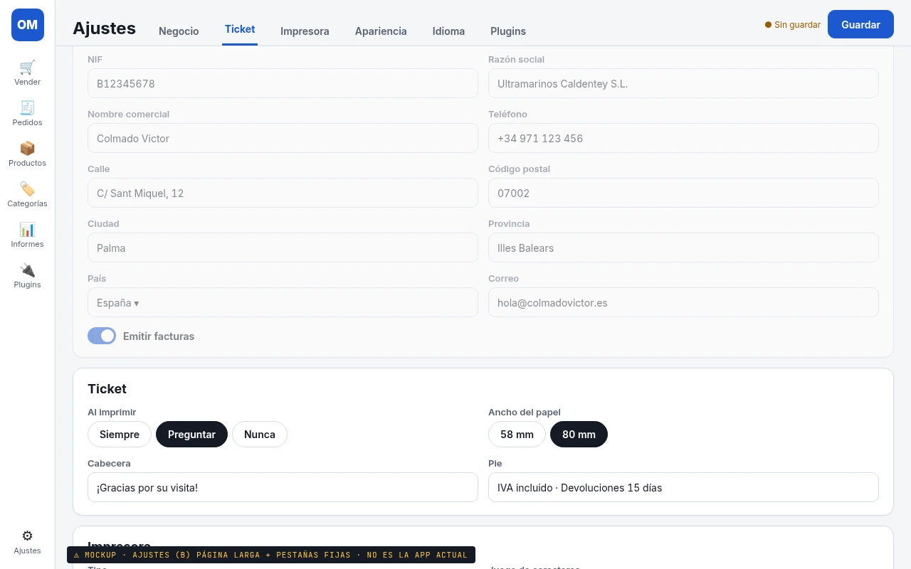 | Smallest code change. Guardar is always visible. | Still a long scroll. Scroll-spy tabs feel fragile. One Guardar for every section makes it unclear what gets saved. |
| **(c) Auto-save per field** 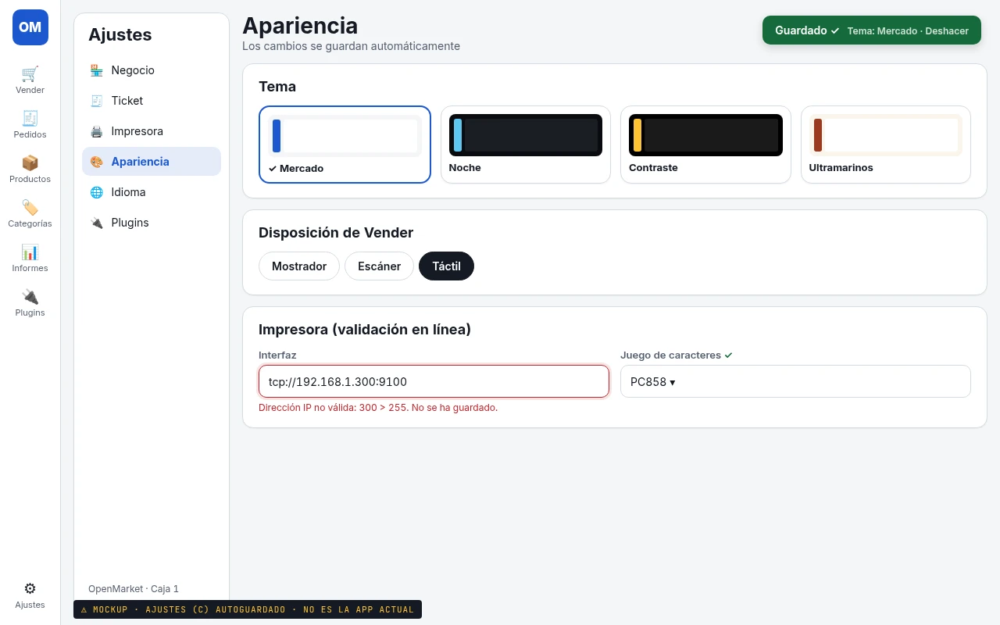 | No button at all. Instant feedback through a "Guardado ✓ · Deshacer" toast. Good for themes and layout. | Risky for fiscal data (NIF, razón social) and printer settings, where a half-typed value would get saved. Needs inline validation and a debounce. |

**Recommendation: (a)**, which matches the Informes secondary nav. Visual-only settings (Apariencia, Idioma) can apply instantly, as in (c), and fiscal and printer fields go through the explicit dirty bar.

## 4. Vender: the weighed-product "Peso (kg)" dialog

**Problem.** The current `order/weighted_dialog` is almost full-width. Its "Cantidad" input is huge and shows a red *Required* error before the user types anything. The keypad stretches across the dialog, and *Añadir* sits bottom-left.

**Proposal.** A compact dialog about 420 px wide that follows the payment modal (A-payment):

| Empty | Weight entered |
|---|---|
| 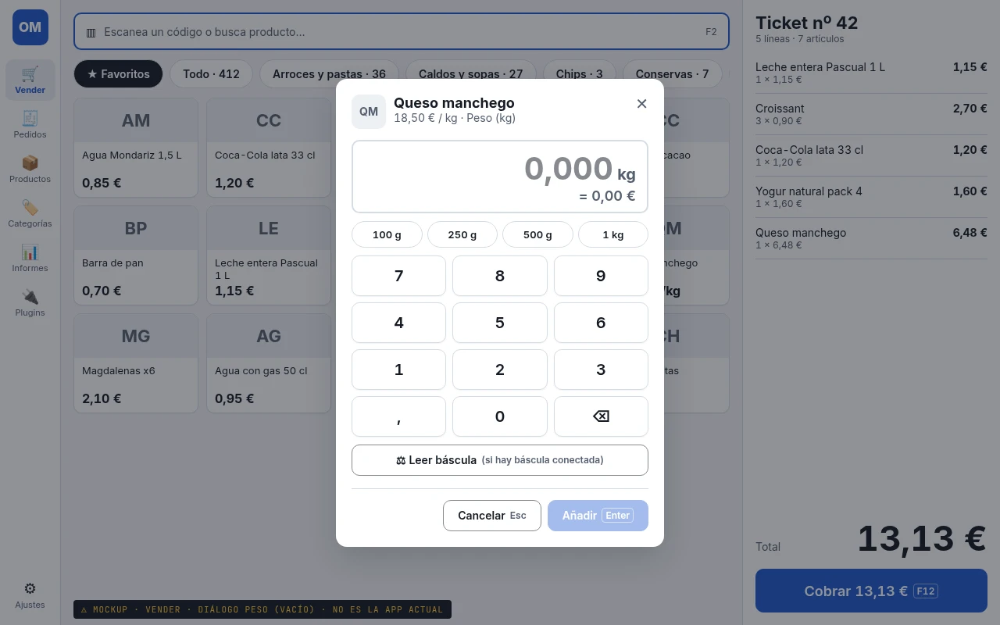 | 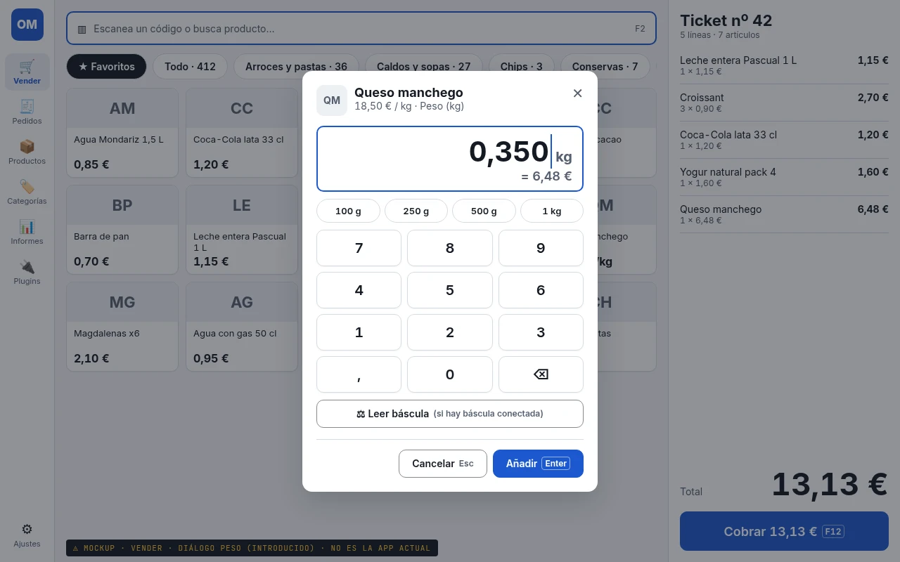 |

- **Header:** product thumbnail, name and price per kg, with a close ✕.
- **Display:** the weight is large and right-aligned, with the unit (`0,000 kg`). The live line total sits under it (`= 6,48 €` for 0,350 kg × 18,50 €/kg).
- **Input:** quick chips for 100 g, 250 g, 500 g and 1 kg, plus a compact 3×4 keypad with a comma and ⌫. The physical keyboard works too.
- **Báscula:** *Leer báscula* only appears when a scale is configured. There is no scale integration yet, so this is a future plugin slot.
- **Validation:** no error before input. *Añadir* stays disabled until the weight is > 0. The error message only appears after a rejected submit attempt.
- **Footer:** right-aligned *Cancelar (Esc)* and primary *Añadir (Enter)*.
